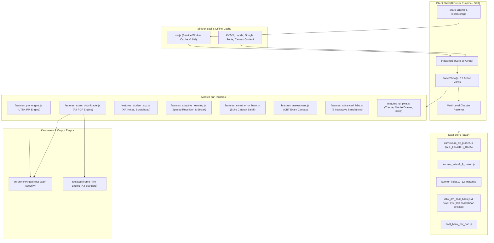

# The Arich Study — Master Blueprint & System Architecture Documentation
> **Dokumentasi Lengkap Arsitektur, Skema Data, Logika State, Protokol Keamanan, dan Panduan Kolaborasi Pengembang (The Arich Study Developer & AI Codex Reference)**

> **Batas keamanan yang berlaku:** Situs ini statis. Profil dan hasil belajar hanya tersimpan di browser/perangkat yang aktif. PIN guru adalah kunci tampilan, bukan autentikasi; semua kunci soal yang dipakai klien bisa dibaca dari berkas publik. Jangan pakai untuk ujian rahasia atau penilaian resmi. Integrasi Google Apps Script lama sudah dihapus dari source aktif, tetapi deployment dan Sheet lama tidak otomatis ikut dicabut.

---

## 1. Ringkasan Eksekutif & Visi Platform (Executive Overview)

**The Arich Study** adalah aplikasi belajar berbasis SPA/PWA dengan materi dan latihan Matematika/Fisika SMP–SMA. Materi tersedia untuk kelas 7–12 dengan kedalaman yang berbeda-beda; Kelas 11 adalah pilot aktif.

1. **Materi dan latihan mandiri:** Materi kurikulum, latihan per bab, simulasi penalaran matematika, alat interaktif, catatan kesalahan, dan cetak PDF.
2. **Hosting statis:** Tidak ada backend aplikasi atau biaya server. Styling Tailwind dibangun saat pengembangan ke `app.css`; browser memuat HTML/CSS/JS statis.
3. **Data lokal:** Profil panggilan, nilai, dan progres disimpan di `localStorage`. Pengguna bisa membuat cadangan JSON dan ekspor CSV. Tidak ada sinkronisasi kelas/perangkat.
4. **Aset pihak ketiga:** Ikon, font, KaTeX, dan confetti dimuat dari CDN publik. Data profil dan nilai tidak dikirim bersama permintaan aset.
5. **Keluaran nonformal:** Rekap dan sertifikat adalah ringkasan/apresiasi latihan buatan aplikasi, bukan dokumen sekolah atau sertifikasi terverifikasi.

---

## 2. Arsitektur Sistem & Diagram Alur (System Architecture)



---

## 3. Struktur Direktori & Manifest Berkas (Directory Manifest)

Platform The Arich Study disusun secara rapi di dalam folder `the_arich_study/`:

```
the_arich_study/
├── index.html                       # Berkas inti SPA (17 view, controller navigasi, modul UI)
├── app.js                           # Alur aplikasi dan penyimpanan lokal
├── app.css                          # Utility CSS Tailwind hasil build untuk hosting statis
├── manifest.json                    # Metadata PWA (nama aplikasi, icon, theme_color)
├── sw.js                            # Service Worker dan cache offline (v1.8.0)
├── theme.css                        # Styling pelengkap, custom dark palette & font styling
├── print.css                        # Aturan cetak PDF A4 presisi (kop, break-inside, font print)
├── package.json                     # Tooling build CSS saja (bukan dependensi runtime browser)
├── tailwind.config.js               # Konfigurasi pemindaian kelas Tailwind
├── tailwind.input.css                # Input build untuk app.css
├── README.md                        # Dokumentasi singkat proyek
├── THE_ARICH_STUDY_MASTER_BLUEPRINT.md # Dokumentasi master arsitektur & skema (berkas ini)
├── icons/                           # Ikon PWA maskable SVG (192px, 512px)
│   ├── icon-192.svg
│   ├── icon-512.svg
│   └── icon-maskable.svg
├── data/                            # Basis data materi Kurikulum Merdeka & Bank Soal
│   ├── curriculum_all_grades.js     # Master registry kurikulum Kelas 7 s/d 12 (ALL_GRADES_DATA)
│   ├── kurmer_kelas7_materi.js      # Materi Kelas 7 SMP (Fase D)
│   ├── kurmer_kelas8_materi.js      # Materi Kelas 8 SMP (Fase D)
│   ├── kurmer_kelas9_materi.js      # Materi Kelas 9 SMP (Fase D)
│   ├── kurmer_kelas10_materi.js     # Modul Pedagogis Fisika & Matematika Kelas 10 (Fase E)
│   ├── kurmer_kelas11_materi.js     # Modul Pedagogis Fisika & Matematika Kelas 11 (Fase F)
│   ├── kurmer_kelas12_materi.js     # Modul Pedagogis Fisika & Matematika Kelas 12 (Fase F Lanjut)
│   ├── utbk_penalaran_matematika.js # Modul dasar Penalaran Matematika
│   ├── utbk_pm_soal_bank.js         # Simulasi Paket 1 UTBK PM (20 Soal, 5 Stimulus)
│   ├── utbk_pm_paket2.js            # Simulasi Paket 2 UTBK PM (20 Soal, 5 Stimulus)
│   ├── utbk_pm_paket3.js            # Simulasi Paket 3 UTBK PM (20 Soal, 5 Stimulus)
│   ├── utbk_pm_paket4.js            # Simulasi Paket 4 UTBK PM (20 Soal, 5 Stimulus)
│   ├── utbk_pm_paket5.js            # Simulasi Paket 5 UTBK PM (20 Soal, 5 Stimulus)
│   ├── soal_bank_per_bab.js         # Bank soal CBT per bab untuk latihan mandiri
│   └── utbk_soal_bank.js            # Bank soal tambahan UTBK TPS
├── features_pm_engine.js            # Mesin UTBK PM, CBT stimulus split, bedah soal, quick strip
├── features_exam_downloader.js      # Universal A4 PDF & Exam Print Engine
├── features_student_exp.js          # Gamifikasi XP, Catatan/Scratchpad, Progres Subtopik, Rapor
├── features_adaptive_learning.js    # Spaced Repetition, Streak Harian, Rekomendasi Remedial
├── features_smart_error_bank.js     # Buku Catatan Salah (Smart Error Bank)
├── features_advanced_labs.js        # 6 Laboratorium Sains & Matematika Interaktif
├── features_assessment.js           # Mesin CBT Ujian Harian & Analisis Hasil
├── features_exam_scratchpad.js      # Coret-coretan interaktif ujian canvas/teks
├── features_ui_pwa.js               # Pengendali tema, drawer sidebar, deteksi offline
└── downloads/                       # Naskah soal latihan siswa; tidak menyimpan PDF kunci guru
```

PDF pembahasan guru disimpan di folder sibling privat, di luar repositori dan hosting statis. Kunci yang ada di bank soal JavaScript tetap dapat dibaca siapa pun; pemindahan PDF hanya mencegah tautan langsung dari situs.

---

## 4. 17 Tampilan SPA & Mesin Navigasi (Single Page Application Views)

Seluruh navigasi platform dikendalikan oleh fungsi tunggal `switchView(viewName)` di [index.html](file:///C:/Users/fahreza%20kautsar/Documents/antigravity/mysterious-borg/the_arich_study/index.html). Ketika tampilan berpindah, seluruh kontainer `<div id="view-{name}">` lainnya disembunyikan (`hidden`), dan target view dibuka secara instan tanpa reload halaman:

| No | ID View (`view-*`) | Fungsi & Deskripsi |
| :---: | :--- | :--- |
| 1 | `student-gate` | Gerbang masuk sederhana: nama panggilan opsional, jenjang kelas, atau profil lokal tersimpan. |
| 2 | `dashboard` | Beranda siswa: widget Lanjut Belajar Terakhir, XP bar, progres level, ringkasan capaian, dan kartu bab kelasnya. |
| 3 | `materi-catalog` | Katalog modul belajar lengkap dengan filter tombol *Semua*, *Matematika*, dan *Fisika*, serta status progres subtopik. |
| 4 | `materi-detail` | Pembaca modul materi interaktif (first-principles), ukuran font (A-, A, A+, A++), TTS baca suara, tips cepat, contoh soal terbimbing, scratchpad, dan tombol cetak PDF / mulai tes. |
| 5 | `exam-catalog` | Katalog latihan CBT per bab dengan status skor tertinggi dan lencana kelulusan (>= 70). |
| 6 | `exam` | Kanvas latihan bertimer 30 menit, navigasi soal, penanda ragu-ragu, dan modal rumus. Bukan ujian berpengawasan. |
| 7 | `exam-result` | Analisis hasil ujian: skor nilai 0-100, radar penguasaan, daftar benar/salah, dan rekomendasi remedial. |
| 8 | `exam-review` | Pembahasan latihan per soal dan rumus KaTeX. |
| 9 | `pm-catalog` | Katalog latihan Penalaran Matematika: 5 paket orisinal (100 soal), masing-masing berdurasi 42 menit 30 detik. |
| 10 | `pm-exam` | Kanvas CBT UTBK PM: layout split-screen (kiri stimulus narasi/tabel/grafik, kanan pertanyaan), strip cepat 20 nomor. |
| 11 | `pm-study` | Mode santai untuk membahas paket latihan; PIN hanya mengatur tampilan kunci di browser. |
| 12 | `pm-review` | Pembahasan lengkap lembar hasil ujian UTBK PM. |
| 13 | `error-bank` | "Buku Catatan Salah": merekam otomatis setiap nomor yang dijawab keliru untuk diulang kembali. |
| 14 | `mathlab` | 6 Simulasi interaktif: Trigonometri lingkaran satuan, Gerak parabola proyektil, Kalkulator matriks, Teorema Pythagoras, Penjumlahan vektor analitis, Probabilitas spinner. |
| 15 | `cheatsheet` | "Buku Sakti": ringkasan rumus cepat matematika & fisika siap pakai. |
| 16 | `history` | Tabel riwayat seluruh nilai ujian siswa di perangkat lokal. |
| 17 | `teacher-dashboard` | Rekap profil dan latihan yang ada di browser ini; tidak menggabungkan data kelas/perangkat dan bukan rapor resmi. |

---

## 5. Skema Data & Model Objek (Data Schemas)

### A. Model Bab Pembelajaran (`Chapter`)
```javascript
{
  "id": "k11-fisika-dinamika-newton",       // String unik ID bab
  "number": "02",                           // Nomor urut bab
  "title": "Fisika Bab 2: Dinamika Gerak Partikel & Aplikasi Hukum Newton",
  "badge": "Fase F • Pilihan Fisika",       // Kategori kurikulum
  "subject": "Fisika",                      // "Matematika" | "Fisika"
  "icon": "zap",                            // Nama ikon Lucide
  "summary": "Analisis interaksi gaya dan penyebab perubahan gerak...", // Ringkasan bab
  "subtopics": [                            // Array subtopik (lihat skema subtopik)
    {
      "title": "1. Konsep Gaya & Hukum I Newton",
      "concept": "Penjelasan mendalam first-principles dengan KaTeX...",
      "quickTip": "⚡ Trik Kilat & Rumus Sakti...",
      "exampleProblem": "Soal terbimbing bertahap..."
    }
  ],
  "questions": [ ... ]                      // Array soal CBT terkait bab ini
}
```

### B. Model Subtopik (`Subtopic`)
```javascript
{
  "title": "Judul Subtopik Terstruktur",
  "concept": "Teks penjelasan teori lengkap. Mendukung markdown ($$ KaTeX math $$) dan poin-poin bertingkat.",
  "quickTip": "Rumus sakti, jalan pintas taktis, atau waspada miskonsepsi.",
  "exampleProblem": "Contoh soal kontekstual bertahap: Diketahui, Ditanya, Langkah KaTeX, Kesimpulan." // Opsional: dapat bernama 'example'
}
```

### C. Model Soal UTBK & CBT (`Question`)
Platform mendukung 3 tipe soal pada paket latihan Penalaran Matematika:
1. **Pilihan Ganda Biasa (`single_choice`):**
   ```javascript
   {
     "id": "pm-p1-q1",
     "type": "single_choice",
     "stimulusId": "stim-1",
     "question": "Berdasarkan stimulus di atas, berapakah nilai...",
     "options": [
       "Rp1.250.000",
       "Rp1.450.000",
       "Rp1.650.000",
       "Rp1.850.000",
       "Rp2.050.000"
     ],
     "correctAnswer": 1,                     // Index 0-based opsi yang benar
     "solution": "Langkah pembahasan KaTeX mendalam...",
     "shortcut": "Formula ringkas The Arich..."
   }
   ```
2. **Pernyataan Benar/Salah Kompleks (`complex_tf`):**
   ```javascript
   {
     "id": "pm-p1-q3",
     "type": "complex_tf",
     "stimulusId": "stim-1",
     "question": "Tentukan kebenaran dari masing-masing pernyataan berikut:",
     "statements": [
       "Biaya sewa rute A lebih efisien daripada rute B.",
       "Kapasitas muat gudang memenuhi batas aman 85%."
     ],
     "correctAnswers": [true, false],        // Array kunci untuk latihan
     "solution": "Pembahasan tiap baris..."
   }
   ```
3. **Isian Numerik / Isian Singkat (`numeric_input`):**
   ```javascript
   {
     "id": "pm-p1-q5",
     "type": "numeric_input",
     "stimulusId": "stim-2",
     "question": "Berapa unit minimal yang harus terjual agar impas?",
     "correctValue": 48,                     // Nilai numerik integer/desimal
     "tolerance": 0,                         // Toleransi selisih jika ada
     "solution": "Turunan perhitungan..."
   }
   ```

### D. Model Stimulus Multisoal (`Stimulus`)
```javascript
{
  "id": "stim-1",
  "title": "Efisiensi Logistik Pengiriman Antar-Kota",
  "theme": "Matematika Finansial & Optimasi",
  "context": "Narasi kontekstual dunia nyata mengenai rantai pasok...",
  "table": {                                // Opsional tabel data terstruktur
    "headers": ["Kota", "Jarak (km)", "Biaya Bahan Bakar"],
    "rows": [
      ["Bandung", "150", "Rp350.000"],
      ["Semarang", "450", "Rp900.000"]
    ]
  },
  "questionIds": ["pm-p1-q1", "pm-p1-q2", "pm-p1-q3"] // Soal-soal yang merujuk stimulus ini
}
```

### E. Model Profil Siswa (`StudentProfile`)
```javascript
{
  "name": "Reza Kautsar",
  "grade": "11",                            // "7", "8", "9", "10", "11", atau "12"
  "school": "SMAN 1 Jakarta"
}
```

### F. Pemetaan Kurikulum & Model Kasus Fisika Kelas 11 (Fase F SMA)
Modul Fisika Kelas 11 disusun berbasis **Case Archetypes** standar asesmen nasional (UH, PTS, PAS, UTBK SNBT) dengan pembagian semester resmi:

#### Semester 1 (Bab 1 s/d Bab 5):
1. **Bab 1: Kinematika Vektor Gerak Lurus, Parabola & Melingkar (`k11-fisika-kinematika`)**
   - *Kasus 1:* Rekonstruksi posisi dari percepatan waktu non-konstan $a(t) = 6t - 4$ via kalkulus integral.
   - *Kasus 2:* Peluru ditembakkan dari puncak tebing setinggi $h$ dengan sudut elevasi $\theta$ & sifat simetri sudut komplementer $\theta$ vs $90^\circ - \theta$.
   - *Kasus 3:* Transmisi 3 model roda (seporos $\omega_A = \omega_B$, singgung luar, dan sabuk/rantai $v_A = v_B$).
2. **Bab 2: Dinamika Gerak Partikel & Aplikasi Hukum Newton (`k11-fisika-dinamika-newton`)**
   - *Kasus 1:* 4 Skenario timbangan orang di dalam lift ($N = m(g \pm a)$ hingga jatuh bebas $N = 0$).
   - *Kasus 2:* Bidang miring kasar, pembuktian sudut kritis meluncur $\tan\theta_c = \mu_s$ yang independen terhadap massa.
   - *Kasus 3:* Pesawat Atwood gantung ganda & katrol meja datar $a = \frac{m_2 - \mu_k m_1}{m_1 + m_2}g$.
   - *Kasus 4:* Tikungan jalan miring licin (*banked road*) $v_{\text{ideal}} = \sqrt{g R \tan\theta}$ dan ayunan konis.
3. **Bab 3: Usaha, Teorema Energi Mekanik, Impuls & Tumbukan (`k11-fisika-usaha-energi-momentum`)**
   - *Kasus 1:* Teorema Usaha-Energi Kinetik via integral grafis $F - x$ ($W_{\text{net}} = \Delta E_k$).
   - *Kasus 2:* Bukti ketinggian kritis pelepasan roller coaster pada loop vertikal $h_{\min} = 2{,}5 R$.
   - *Kasus 3:* Ayunan balistik dua tahap (tumbukan momentum tak lenting + ayunan naik energi mekanik) dan pantulan bola berulang $h_n = e^{2n} h_0$.
4. **Bab 4: Dinamika Rotasi & Kesetimbangan Benda Tegar (`k11-fisika-dinamika-rotasi`)**
   - *Kasus 1:* Torsi poros ujung batang homogen $I = \frac{1}{3}ML^2$ dan teorema sumbu sejajar.
   - *Kasus 2:* Balapan menggelinding murni di bidang miring $v = \sqrt{\frac{2gh}{1+k}}$, pembuktian bola pejal menang atas silinder/cincin, dan katrol bermassa masif.
   - *Kasus 3:* Kesetimbangan tangga bersandar pada dinding licin dan lantai kasar $\tan\theta_{\min} = \frac{1}{2\mu_s}$ serta titik berat benda berlubang.
5. **Bab 5: Mekanika Fluida Statis & Dinamis (`k11-fisika-fluida`)**
   - *Kasus 1:* Bejana berhubungan pipa U multi-cairan ($\rho_1 h_1 = \rho_2 h_2$) dan dongkrak Pascal.
   - *Kasus 2:* Persentase terapung Archimedes $\frac{\rho_b}{\rho_f} = \frac{V_{\text{celup}}}{V_{\text{total}}}$ dan kecepatan terminal Stokes bola dalam fluida kental.
   - *Kasus 3:* Teorema Torricelli tangki bocor ($v = \sqrt{2gh_1}$, $X = 2\sqrt{h_1 h_2}$), venturimeter, dan gaya angkat sayap pesawat.

#### Semester 2 (Bab 6 s/d Bab 7):
6. **Bab 6: Gelombang Mekanik, Bunyi & Optika Gelombang Cahaya (`k11-fisika-gelombang-bunyi-cahaya`)**
   - *Kasus 1:* Persamaan gelombang sinusoidal $y = A \sin(\omega t \mp kx)$, kelajuan fase $v = \omega / k$, dan beda fase.
   - *Kasus 2:* Resonansi pipa organa terbuka vs tertutup, efek Doppler menyeluruh dengan tanda relatif, dan taraf intensitas desibel (jarak $r_2$ dan multi-sumber $n$).
   - *Kasus 3:* Interferensi celah ganda Young ($d \frac{y}{L} = n \lambda$) dan difraksi kisi $d \sin\theta = n \lambda$.
7. **Bab 7: Suhu, Teori Kinetik Gas & Hukum Termodinamika (`k11-fisika-termodinamika`)**
   - *Kasus 1:* Uji kalor lebur Asas Black campuran es-air (mendeteksi wujud akhir $0^\circ\text{C}$ vs mencair tuntas).
   - *Kasus 2:* Derajat kebebasan ekuipartisi gas diatomik pada suhu rendah (3), sedang (5), dan tinggi (7).
   - *Kasus 3:* Usaha siklus grafis $P - V$ dan perhitungan perubahan efisiensi mesin Carnot $\eta = 1 - \frac{T_C}{T_H}$.

---

## 6. Logika Multi-Level Chapter Resolver (Penyelesaian Bab Anti-Gagal)

Fungsi `openChapterDetail(chapterId, optionalGradeId)` di [index.html](file:///C:/Users/fahreza%20kautsar/Documents/antigravity/mysterious-borg/the_arich_study/index.html) menggunakan algoritma resolusi 4 lapis untuk mencegah *silent abort* atau kegagalan saat siswa membaca materi lintas jenjang:

```javascript
function openChapterDetail(chapterId, optionalGradeId) {
  if (!chapterId) return;

  const studentGrade = currentStudent ? String(currentStudent.grade) : '11';
  let ch = null;
  let targetGrade = optionalGradeId ? String(optionalGradeId) : null;

  // Lapis 1: Jika targetGrade diminta spesifik, cari di jenjang tersebut
  if (targetGrade && window.ALL_GRADES_DATA?.[targetGrade]?.chapters) {
    ch = window.ALL_GRADES_DATA[targetGrade].chapters.find(c => c.id === chapterId);
  }

  // Lapis 2: Cari di kurikulum aktif saat ini (currentGradeData)
  if (!ch && currentGradeData?.chapters) {
    ch = currentGradeData.chapters.find(c => c.id === chapterId);
    if (ch) targetGrade = studentGrade;
  }

  // Lapis 3: Cari di kelas akun terdaftar siswa
  if (!ch && window.ALL_GRADES_DATA?.[studentGrade]?.chapters) {
    ch = window.ALL_GRADES_DATA[studentGrade].chapters.find(c => c.id === chapterId);
    if (ch) targetGrade = studentGrade;
  }

  // Lapis 4: Fallback menyeluruh menyisir seluruh ALL_GRADES_DATA (Kelas 7 - 12)
  if (!ch && window.ALL_GRADES_DATA) {
    for (const [gKey, gData] of Object.entries(window.ALL_GRADES_DATA)) {
      if (gData?.chapters) {
        const found = gData.chapters.find(c => c.id === chapterId);
        if (found) {
          ch = found;
          targetGrade = gKey;
          break;
        }
      }
    }
  }

  if (!ch) {
    console.warn('[TheArichStudy] Bab tidak ditemukan:', chapterId);
    return;
  }

  // Set state aktif dan tampilkan
  targetGrade = targetGrade || studentGrade;
  activeReadingGrade = targetGrade;
  window.currentDetailChapter = ch;
  window.currentDetailGrade = targetGrade;
  // ... render materi & switchView('materi-detail')
}
```

---

## 7. Batas Keamanan dan Mode Guru

Mode Guru memakai PIN yang diperiksa oleh JavaScript publik di browser. Ini hanya kontrol tampilan untuk belajar bersama, bukan login atau otorisasi keamanan. Siswa yang membuka source, cache, atau berkas bank soal tetap dapat menemukan kunci dan pembahasan.

- Jangan gunakan situs ini untuk ujian rahasia, ujian berpengawasan, atau penilaian yang membutuhkan bukti identitas dan integritas.
- Jangan menaruh soal rahasia, data sekolah, nama lengkap, atau data sensitif pada materi yang dipublikasikan.
- Data profil/nilai disimpan pada `localStorage` perangkat aktif. Tidak ada sinkronisasi akun; menghapus data browser dapat menghapus progres kecuali pengguna menyimpan cadangan JSON.
- CSV dan JSON cadangan harus dibagikan dengan hati-hati karena berisi data belajar lokal.
- Riwayat source lama pernah berisi konfigurasi Google Apps Script. Source aktif sudah menghapus jalur sync, tetapi deployment Google yang pernah dibuat dan data spreadsheet lama harus dicabut/dihapus terpisah oleh pemilik akun.
- PDF kunci guru dipindah ke folder privat di luar repositori. Ini tidak membuat kunci di file JavaScript menjadi rahasia.

---

## 8. Universal A4 PDF & Exam Downloader Engine (`features_exam_downloader.js`)

Modul ini adalah mesin pembuat dokumen PDF cetak mandiri yang bekerja murni di browser:
- **Teknologi:** Menggunakan isolated hidden `<iframe>` untuk membangun dokumen HTML standar A4, memicu `window.print()` di dalam iframe tersebut sehingga tidak merusak atau merefresh DOM halaman utama aplikasi.
- **Cetak latihan:**
  - Header lembar latihan bermerek The Arich Study; tidak mewakili lembaga/ujian nasional.
  - Tabel metadata identitas (Mata Pelajaran, Kelas, Waktu, Tanggal) dengan titik dua (`:`) yang rata kiri sempurna (*aligned colons*).
  - Kotak petunjuk teknis ujian (*Rubrik Pedoman Pengerjaan*).
- **Tipografi Cetak ([print.css](file:///C:/Users/fahreza%20kautsar/Documents/antigravity/mysterious-borg/the_arich_study/print.css)):**
  - Menggunakan font serif/sans formal dengan kontras hitam-putih tajam untuk penghematan tinta printer.
  - Aturan `@page { size: A4; margin: 15mm 12mm 15mm 12mm; }`.
  - Aturan `page-break-inside: avoid;` pada setiap nomor soal agar soal tidak terpotong canggung di batas halaman (*orphan/widow prevention*).

---

## 9. PWA, Service Worker & Strategi Offline (`sw.js`)

Aplikasi The Arich Study menyediakan cache offline dengan Service Worker versi `v1.8.0`:
1. **Daftar Pre-cache (`PRECACHE_ASSETS`):**
   Seluruh aset inti aplikasi (HTML, CSS, semua berkas modul fitur JS, semua modul kurikulum materi `kurmer_kelas*.js`, bank soal per bab, dan bank soal UTBK PM 1-5) di-precache saat instalasi.
2. **Aset build lokal dan CDN (`CDN_CACHE_NAME`):**
   `app.css` dibangun lokal dan masuk precache. KaTeX, Lucide versi yang dipatok, Canvas Confetti, dan Google Fonts tetap berasal dari CDN serta di-cache setelah tersedia.
3. **Navigasi HTML:**
   Strategi *Network-First* dengan fallback ke `index.html` cache offline jika tidak ada koneksi internet.

---

## 10. Panduan Kolaborasi Pengembang & Codex (Guidelines for Codex)

Bagi pengembang manusia maupun agen AI (Codex) yang bekerja pada repositori ini:

### Aturan Arsitektur & Koding:
1. **Pertahankan Pure Vanilla JS Modular:** Hindari memasukkan library framework runtime berat (React, Vue, Webpack, Vite, dll.) ke dalam runtime publik kecuali diminta secara eksplisit oleh pemilik proyek. Arsitektur harus tetap ringan, langsung dapat dijalankan via browser statis apa pun.
2. **Batas Kunci Jawaban:** Kontrol PIN di browser bukan proteksi. Jangan menjanjikan kunci tersembunyi/aman; untuk ujian rahasia diperlukan backend autentikasi dan pemberian soal per sesi, yang tidak tersedia pada arsitektur gratis statis ini.
3. **Penulisan LaTeX / Matematika:**
   - Gunakan delimiter `$...$` untuk inline math KaTeX dan `$$...$$` untuk display math.
   - Jangan menggunakan teks HTML di dalam KaTeX math block.
   - Setelah memodifikasi DOM yang berisi KaTeX baru, selalu panggil `triggerLatex(containerElement)` atau `renderMathInElement`.
4. **Ikonografi:** Gunakan Lucide icons via `<i data-lucide="icon-name"></i>`. Setelah memanipulasi DOM yang menyisipkan ikon baru, panggil `lucide.createIcons()`.
5. **Dukungan Dua Viewport:** Setiap perubahan UI wajib responsif baik pada tampilan Desktop (>= 1024px) maupun Mobile Smartphone (360px - 414px).

### Pemeriksaan perubahan:
Jalankan `npm run build:css` setelah mengubah kelas Tailwind. Pemeriksaan UI atau tes otomatis dilakukan saat diminta pengguna; jangan menyebut lock PIN sebagai pengamanan ujian.
