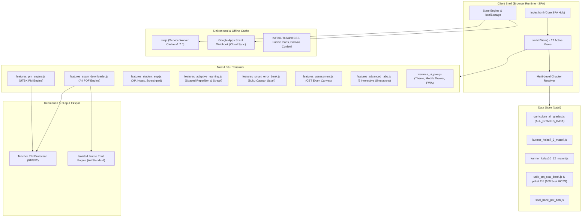

# The Arich Study — Master Blueprint & System Architecture Documentation
> **Dokumentasi Lengkap Arsitektur, Skema Data, Logika State, Protokol Keamanan, dan Panduan Kolaborasi Pengembang (The Arich Study Developer & AI Codex Reference)**

---

## 1. Ringkasan Eksekutif & Visi Platform (Executive Overview)

**The Arich Study** adalah platform pembelajaran digital mutakhir berbasis web (*Single Page Application / Progressive Web App*) yang dirancang khusus untuk jenjang **SMP (Kelas 7, 8, 9)** dan **SMA (Kelas 10, 11, 12)** dengan fokus mendalam pada:
1. **Kurikulum Merdeka — Matematika & Fisika:** Disajikan dengan pendekatan *first-principles pedagogical approach* (penurunan konsep dari nol, intuisi fisis, analogi nyata, peringatan miskonsepsi, dan langkah terstruktur bertahap).
2. **Penalaran Matematika (PM) UTBK-SNBT BP3 2026:** Standar simulasi Computer-Based Test (CBT) resmi dengan stimulus multisoal, navigasi 20 soal HOTS, mode bedah soal santai (*study mode*), dan proteksi kunci jawaban.
3. **Keamanan Mode Guru (Teacher Mode):** Proteksi kunci jawaban resmi dan pembahasan langkah KaTeX di balik otentikasi PIN guru (`010822`).
4. **Universal A4 PDF Compiler:** Kemampuan mengompilasi dan mencetak dokumen naskah soal resmi kop standar ujian dan lembar pembahasan langsung dari browser secara offline tanpa dependensi server backend.
5. **Zero Backend Runtime Dependency:** 100% berjalan di sisi klien (Client-Side Vanilla JS + Tailwind CSS + KaTeX), dapat di-deploy langsung di GitHub Pages atau server statis apa pun, dengan sinkronisasi opsional ke Google Sheets via Google Apps Script (GAS).

---

## 2. Arsitektur Sistem & Diagram Alur (System Architecture)



---

## 3. Struktur Direktori & Manifest Berkas (Directory Manifest)

Platform The Arich Study disusun secara rapi di dalam folder `the_arich_study/`:

```
the_arich_study/
├── index.html                       # Berkas inti SPA (17 view, controller navigasi, modul UI)
├── manifest.json                    # Metadata PWA (nama aplikasi, icon, theme_color)
├── sw.js                            # Service Worker offline-first (v1.7.0)
├── theme.css                        # Styling pelengkap, custom dark palette & font styling
├── print.css                        # Aturan cetak PDF A4 presisi (kop, break-inside, font print)
├── README.md                        # Dokumentasi singkat proyek
├── THE_ARICH_STUDY_MASTER_BLUEPRINT.md # Dokumentasi master arsitektur & skema (berkas ini)
├── icons/                           # Ikon PWA maskable SVG (192px, 512px)
│   ├── icon-192.svg
│   ├── icon-512.svg
│   └── icon-maskable.svg
├── data/                            # Basis data materi Kurikulum Merdeka & Bank Soal
│   ├── cloud_config.js              # URL Webhook Google Apps Script untuk cloud sync
│   ├── curriculum_all_grades.js     # Master registry kurikulum Kelas 7 s/d 12 (ALL_GRADES_DATA)
│   ├── kurmer_kelas7_materi.js      # Materi Kelas 7 SMP (Fase D)
│   ├── kurmer_kelas8_materi.js      # Materi Kelas 8 SMP (Fase D)
│   ├── kurmer_kelas9_materi.js      # Materi Kelas 9 SMP (Fase D)
│   ├── kurmer_kelas10_materi.js     # Modul Pedagogis Fisika & Matematika Kelas 10 (Fase E)
│   ├── kurmer_kelas11_materi.js     # Modul Pedagogis Fisika & Matematika Kelas 11 (Fase F)
│   ├── kurmer_kelas12_materi.js     # Modul Pedagogis Fisika & Matematika Kelas 12 (Fase F Lanjut)
│   ├── utbk_penalaran_matematika.js # Modul dasar Penalaran Matematika
│   ├── utbk_pm_soal_bank.js         # Simulasi Paket 1 UTBK PM (20 Soal, 5 Stimulus)
│   ├── utbk_pm_paket2.js            # Simulasi Paket 2 UTBK PM (20 Soal, 5 Stimulus)
│   ├── utbk_pm_paket3.js            # Simulasi Paket 3 UTBK PM (20 Soal, 5 Stimulus)
│   ├── utbk_pm_paket4.js            # Simulasi Paket 4 UTBK PM (20 Soal, 5 Stimulus)
│   ├── utbk_pm_paket5.js            # Simulasi Paket 5 UTBK PM (20 Soal, 5 Stimulus)
│   ├── soal_bank_per_bab.js         # Bank soal CBT per bab untuk latihan mandiri
│   └── utbk_soal_bank.js            # Bank soal tambahan UTBK TPS
├── features_pm_engine.js            # Mesin UTBK PM, CBT stimulus split, bedah soal, quick strip
├── features_exam_downloader.js      # Universal A4 PDF & Exam Print Engine
├── features_student_exp.js          # Gamifikasi XP, Catatan/Scratchpad, Progres Subtopik, Rapor
├── features_adaptive_learning.js    # Spaced Repetition, Streak Harian, Rekomendasi Remedial
├── features_smart_error_bank.js     # Buku Catatan Salah (Smart Error Bank)
├── features_advanced_labs.js        # 6 Laboratorium Sains & Matematika Interaktif
├── features_assessment.js           # Mesin CBT Ujian Harian & Analisis Hasil
├── features_exam_scratchpad.js      # Coret-coretan interaktif ujian canvas/teks
├── features_ui_pwa.js               # Pengendali tema, drawer sidebar, deteksi offline
└── GOOGLE_APPS_SCRIPT.gs            # Skrip Google Apps Script untuk Google Sheets Database
```

---

## 4. 17 Tampilan SPA & Mesin Navigasi (Single Page Application Views)

Seluruh navigasi platform dikendalikan oleh fungsi tunggal `switchView(viewName)` di [index.html](file:///C:/Users/fahreza%20kautsar/Documents/antigravity/mysterious-borg/the_arich_study/index.html). Ketika tampilan berpindah, seluruh kontainer `<div id="view-{name}">` lainnya disembunyikan (`hidden`), dan target view dibuka secara instan tanpa reload halaman:

| No | ID View (`view-*`) | Fungsi & Deskripsi |
| :---: | :--- | :--- |
| 1 | `student-gate` | Gerbang masuk siswa: input nama, jenjang kelas (7-12), sekolah, atau pilih akun tersimpan di perangkat. |
| 2 | `dashboard` | Beranda siswa: widget Lanjut Belajar Terakhir, XP bar, progres level, ringkasan capaian, dan kartu bab kelasnya. |
| 3 | `materi-catalog` | Katalog modul belajar lengkap dengan filter tombol *Semua*, *Matematika*, dan *Fisika*, serta status progres subtopik. |
| 4 | `materi-detail` | Pembaca modul materi interaktif (first-principles), ukuran font (A-, A, A+, A++), TTS baca suara, tips cepat, contoh soal terbimbing, scratchpad, dan tombol cetak PDF / mulai tes. |
| 5 | `exam-catalog` | Katalog latihan CBT per bab dengan status skor tertinggi dan lencana kelulusan (>= 70). |
| 6 | `exam` | Kanvas ujian CBT resmi: timer hitung mundur 30 menit, navigasi nomor, ragu-ragu, dan modal rumus sakti. |
| 7 | `exam-result` | Analisis hasil ujian: skor nilai 0-100, radar penguasaan, daftar benar/salah, dan rekomendasi remedial. |
| 8 | `exam-review` | Pembahasan soal nomor per nomor lengkap dengan kunci resmi dan penurunan KaTeX. |
| 9 | `pm-catalog` | Katalog khusus UTBK Penalaran Matematika: 5 Paket Simulasi (100 Soal) dengan estimasi waktu & tingkat HOTS. |
| 10 | `pm-exam` | Kanvas CBT UTBK PM: layout split-screen (kiri stimulus narasi/tabel/grafik, kanan pertanyaan), strip cepat 20 nomor. |
| 11 | `pm-study` | Mode Santai "Bedah Soal" UTBK: eksplorasi soal satu per satu dengan proteksi kunci Mode Guru vs Mode Siswa. |
| 12 | `pm-review` | Pembahasan lengkap lembar hasil ujian UTBK PM. |
| 13 | `error-bank` | "Buku Catatan Salah": merekam otomatis setiap nomor yang dijawab keliru untuk diulang kembali. |
| 14 | `mathlab` | 6 Simulasi interaktif: Trigonometri lingkaran satuan, Gerak parabola proyektil, Kalkulator matriks, Teorema Pythagoras, Penjumlahan vektor analitis, Probabilitas spinner. |
| 15 | `cheatsheet` | "Buku Sakti": ringkasan rumus cepat matematika & fisika siap pakai. |
| 16 | `history` | Tabel riwayat seluruh nilai ujian siswa di perangkat lokal. |
| 17 | `teacher-dashboard` | Portal Guru: rekapitulasi nilai seluruh siswa, rata-rata kelas, dan cetak rapor format PDF resmi. |

---

## 5. Skema Data & Model Objek (Data Schemas)

### A. Model Bab Pembelajaran (`Chapter`)
```javascript
{
  "id": "k11-fisika-dinamika-newton",       // String unik ID bab
  "number": "02",                           // Nomor urut bab
  "title": "Fisika Bab 2: Dinamika Gerak Partikel & Aplikasi Hukum Newton",
  "badge": "Fase F • Pilihan Fisika",       // Kategori kurikulum
  "subject": "Fisika",                      // "Matematika" | "Fisika"
  "icon": "zap",                            // Nama ikon Lucide
  "summary": "Analisis interaksi gaya dan penyebab perubahan gerak...", // Ringkasan bab
  "subtopics": [                            // Array subtopik (lihat skema subtopik)
    {
      "title": "1. Konsep Gaya & Hukum I Newton",
      "concept": "Penjelasan mendalam first-principles dengan KaTeX...",
      "quickTip": "⚡ Trik Kilat & Rumus Sakti...",
      "exampleProblem": "Soal terbimbing bertahap..."
    }
  ],
  "questions": [ ... ]                      // Array soal CBT terkait bab ini
}
```

### B. Model Subtopik (`Subtopic`)
```javascript
{
  "title": "Judul Subtopik Terstruktur",
  "concept": "Teks penjelasan teori lengkap. Mendukung markdown ($$ KaTeX math $$) dan poin-poin bertingkat.",
  "quickTip": "Rumus sakti, jalan pintas taktis, atau waspada miskonsepsi.",
  "exampleProblem": "Contoh soal kontekstual bertahap: Diketahui, Ditanya, Langkah KaTeX, Kesimpulan." // Opsional: dapat bernama 'example'
}
```

### C. Model Soal UTBK & CBT (`Question`)
Platform mendukung 3 tipe soal standar BP3:
1. **Pilihan Ganda Biasa (`single_choice`):**
   ```javascript
   {
     "id": "pm-p1-q1",
     "type": "single_choice",
     "stimulusId": "stim-1",
     "question": "Berdasarkan stimulus di atas, berapakah nilai...",
     "options": [
       "Rp1.250.000",
       "Rp1.450.000",
       "Rp1.650.000",
       "Rp1.850.000",
       "Rp2.050.000"
     ],
     "correctAnswer": 1,                     // Index 0-based opsi yang benar
     "solution": "Langkah pembahasan KaTeX mendalam...",
     "shortcut": "Formula ringkas The Arich..."
   }
   ```
2. **Pernyataan Benar/Salah Kompleks (`complex_tf`):**
   ```javascript
   {
     "id": "pm-p1-q3",
     "type": "complex_tf",
     "stimulusId": "stim-1",
     "question": "Tentukan kebenaran dari masing-masing pernyataan berikut:",
     "statements": [
       "Biaya sewa rute A lebih efisien daripada rute B.",
       "Kapasitas muat gudang memenuhi batas aman 85%."
     ],
     "correctAnswers": [true, false],        // Array boolean kunci resmi
     "solution": "Pembahasan tiap baris..."
   }
   ```
3. **Isian Numerik / Isian Singkat (`numeric_input`):**
   ```javascript
   {
     "id": "pm-p1-q5",
     "type": "numeric_input",
     "stimulusId": "stim-2",
     "question": "Berapa unit minimal yang harus terjual agar impas?",
     "correctValue": 48,                     // Nilai numerik integer/desimal
     "tolerance": 0,                         // Toleransi selisih jika ada
     "solution": "Turunan perhitungan..."
   }
   ```

### D. Model Stimulus Multisoal (`Stimulus`)
```javascript
{
  "id": "stim-1",
  "title": "Efisiensi Logistik Pengiriman Antar-Kota",
  "theme": "Matematika Finansial & Optimasi",
  "context": "Narasi kontekstual dunia nyata mengenai rantai pasok...",
  "table": {                                // Opsional tabel data terstruktur
    "headers": ["Kota", "Jarak (km)", "Biaya Bahan Bakar"],
    "rows": [
      ["Bandung", "150", "Rp350.000"],
      ["Semarang", "450", "Rp900.000"]
    ]
  },
  "questionIds": ["pm-p1-q1", "pm-p1-q2", "pm-p1-q3"] // Soal-soal yang merujuk stimulus ini
}
```

### E. Model Profil Siswa (`StudentProfile`)
```javascript
{
  "name": "Reza Kautsar",
  "grade": "11",                            // "7", "8", "9", "10", "11", atau "12"
  "school": "SMAN 1 Jakarta"
}
```

---

## 6. Logika Multi-Level Chapter Resolver (Penyelesaian Bab Anti-Gagal)

Fungsi `openChapterDetail(chapterId, optionalGradeId)` di [index.html](file:///C:/Users/fahreza%20kautsar/Documents/antigravity/mysterious-borg/the_arich_study/index.html) menggunakan algoritma resolusi 4 lapis untuk mencegah *silent abort* atau kegagalan saat siswa membaca materi lintas jenjang:

```javascript
function openChapterDetail(chapterId, optionalGradeId) {
  if (!chapterId) return;

  const studentGrade = currentStudent ? String(currentStudent.grade) : '11';
  let ch = null;
  let targetGrade = optionalGradeId ? String(optionalGradeId) : null;

  // Lapis 1: Jika targetGrade diminta spesifik, cari di jenjang tersebut
  if (targetGrade && window.ALL_GRADES_DATA?.[targetGrade]?.chapters) {
    ch = window.ALL_GRADES_DATA[targetGrade].chapters.find(c => c.id === chapterId);
  }

  // Lapis 2: Cari di kurikulum aktif saat ini (currentGradeData)
  if (!ch && currentGradeData?.chapters) {
    ch = currentGradeData.chapters.find(c => c.id === chapterId);
    if (ch) targetGrade = studentGrade;
  }

  // Lapis 3: Cari di kelas akun terdaftar siswa
  if (!ch && window.ALL_GRADES_DATA?.[studentGrade]?.chapters) {
    ch = window.ALL_GRADES_DATA[studentGrade].chapters.find(c => c.id === chapterId);
    if (ch) targetGrade = studentGrade;
  }

  // Lapis 4: Fallback menyeluruh menyisir seluruh ALL_GRADES_DATA (Kelas 7 - 12)
  if (!ch && window.ALL_GRADES_DATA) {
    for (const [gKey, gData] of Object.entries(window.ALL_GRADES_DATA)) {
      if (gData?.chapters) {
        const found = gData.chapters.find(c => c.id === chapterId);
        if (found) {
          ch = found;
          targetGrade = gKey;
          break;
        }
      }
    }
  }

  if (!ch) {
    console.warn('[TheArichStudy] Bab tidak ditemukan:', chapterId);
    return;
  }

  // Set state aktif dan tampilkan
  targetGrade = targetGrade || studentGrade;
  activeReadingGrade = targetGrade;
  window.currentDetailChapter = ch;
  window.currentDetailGrade = targetGrade;
  // ... render materi & switchView('materi-detail')
}
```

---

## 7. Protokol Keamanan & Mode Guru (Teacher Mode Protocol)

Untuk menjaga integritas belajar dan mencegah siswa melihat kunci jawaban sebelum menyelesaikan latihan:

1. **State Kunci:**
   - Status Mode Guru disimpan pada flag global `window.isTeacherUnlocked` (boolean, default: `false`).
   - PIN Resmi: `010822` (atau `090305`).
2. **Perilaku Mode Siswa (`!window.isTeacherUnlocked`):**
   - **Tampilan Bedah Soal PM ([features_pm_engine.js](file:///C:/Users/fahreza%20kautsar/Documents/antigravity/mysterious-borg/the_arich_study/features_pm_engine.js)):**
     - Kartu Kunci Jawaban Resmi, Pembahasan KaTeX langkah demi langkah, dan Formula Praktis **disembunyikan sepenuhnya**.
     - Ditampilkan kartu pemberitahuan: *"Mode Siswa: Kunci Resmi & KaTeX Terkunci (Latihan Objektif)"* beserta tombol untuk memasukkan PIN Pengajar jika guru sedang mendampingi.
     - Pilihan ganda bersifat interaktif dengan penanda netral (highlight biru indigo) **tanpa penanda hijau (kunci) atau merah**.
     - Soal Benar/Salah dan Isian Numerik menyimpan jawaban siswa tanpa membocorkan kebenaran atau nilai angka kunci.
   - **Cetak / Unduh PDF ([features_exam_downloader.js](file:///C:/Users/fahreza%20kautsar/Documents/antigravity/mysterious-borg/the_arich_study/features_exam_downloader.js)):**
     - Opsi *"Naskah Soal + Kunci & Solusi"* dan *"Hanya Kunci Jawaban & KaTeX"* dikunci dengan lencana `🔒 Mode Guru`.
     - Jika siswa menekan tombol Cetak/Unduh, sistem secara otomatis memaksa format dokumen menjadi **"soal_only"** (Naskah Soal Saja Bersih Tanpa Kunci).
3. **Perilaku Mode Guru (`window.isTeacherUnlocked === true`):**
   - Menampilkan seluruh kartu kunci resmi (`Standar BP3 • Mode Guru Aktif`), langkah KaTeX, dan trik kilat.
   - Pilihan ganda menyoroti jawaban benar dengan badge hijau `✓ Kunci Resmi`.
   - Seluruh 3 format cetak PDF terbuka penuh.
   - Bar atas menampilkan status aktif `Mode Guru (Kunci Aktif)`.
   - Ketika PIN berhasil diverifikasi, sistem memicu callback `onTeacherModeChange()` di seluruh komponen yang aktif tanpa memaksa pindah halaman (*seamless in-place refresh*).

---

## 8. Universal A4 PDF & Exam Downloader Engine (`features_exam_downloader.js`)

Modul ini adalah mesin pembuat dokumen PDF cetak mandiri yang bekerja murni di browser:
- **Teknologi:** Menggunakan isolated hidden `<iframe>` untuk membangun dokumen HTML standar A4, memicu `window.print()` di dalam iframe tersebut sehingga tidak merusak atau merefresh DOM halaman utama aplikasi.
- **Kop Surat Ujian Resmi:**
  - Header kop standar lembaga/ujian nasional dengan garis ganda (*double rule*).
  - Tabel metadata identitas (Mata Pelajaran, Kelas, Waktu, Tanggal) dengan titik dua (`:`) yang rata kiri sempurna (*aligned colons*).
  - Kotak petunjuk teknis ujian (*Rubrik Pedoman Pengerjaan*).
- **Tipografi Cetak ([print.css](file:///C:/Users/fahreza%20kautsar/Documents/antigravity/mysterious-borg/the_arich_study/print.css)):**
  - Menggunakan font serif/sans formal dengan kontras hitam-putih tajam untuk penghematan tinta printer.
  - Aturan `@page { size: A4; margin: 15mm 12mm 15mm 12mm; }`.
  - Aturan `page-break-inside: avoid;` pada setiap nomor soal agar soal tidak terpotong canggung di batas halaman (*orphan/widow prevention*).

---

## 9. PWA, Service Worker & Strategi Offline (`sw.js`)

Aplikasi The Arich Study merupakan PWA penuh dengan Service Worker versi `v1.7.0`:
1. **Daftar Pre-cache (`PRECACHE_ASSETS`):**
   Seluruh aset inti aplikasi (HTML, CSS, semua berkas modul fitur JS, semua modul kurikulum materi `kurmer_kelas*.js`, bank soal per bab, dan bank soal UTBK PM 1-5) di-precache saat instalasi.
2. **Caching Pihak Ketiga (`CDN_CACHE_NAME`):**
   KaTeX (CSS, JS, auto-render), Tailwind CDN, Lucide Icons, Canvas Confetti, dan Google Fonts di-cache dengan strategi *Cache-First with Background Revalidation*.
3. **Navigasi HTML:**
   Strategi *Network-First* dengan fallback ke `index.html` cache offline jika tidak ada koneksi internet.

---

## 10. Panduan Kolaborasi Pengembang & Codex (Guidelines for Codex)

Bagi pengembang manusia maupun agen AI (Codex) yang bekerja pada repositori ini:

### Aturan Arsitektur & Koding:
1. **Pertahankan Pure Vanilla JS Modular:** Hindari memasukkan library framework runtime berat (React, Vue, Webpack, Vite, dll.) ke dalam runtime publik kecuali diminta secara eksplisit oleh pemilik proyek. Arsitektur harus tetap ringan, langsung dapat dijalankan via browser statis apa pun.
2. **Keamanan Kunci Jawaban:** Jangan pernah merender atau membocorkan `correctAnswer`, `correctAnswers`, `correctValue`, atau `solution` kepada siswa kecuali `window.isTeacherUnlocked === true`.
3. **Penulisan LaTeX / Matematika:**
   - Gunakan delimiter `$...$` untuk inline math KaTeX dan `$$...$$` untuk display math.
   - Jangan menggunakan teks HTML di dalam KaTeX math block.
   - Setelah memodifikasi DOM yang berisi KaTeX baru, selalu panggil `triggerLatex(containerElement)` atau `renderMathInElement`.
4. **Ikonografi:** Gunakan Lucide icons via `<i data-lucide="icon-name"></i>`. Setelah memanipulasi DOM yang menyisipkan ikon baru, panggil `lucide.createIcons()`.
5. **Dukungan Dua Viewport:** Setiap perubahan UI wajib responsif baik pada tampilan Desktop (>= 1024px) maupun Mobile Smartphone (360px - 414px).

### Protokol Verifikasi Wajib (Crosscheck Battery):
Sebelum menyatakan tugas selesai, wajib menjalankan pengujian otomatis:
```bash
# Contoh pengujian via playwright headless browser:
python -c "
# 1. Buka http://localhost:8080/the_arich_study/
# 2. Uji alur login Kelas 10, 11, dan 12
# 3. Klik seluruh bab materi dan pastikan materi terbuka sempurna
# 4. Verifikasi bahwa kunci jawaban terkunci di Mode Siswa
# 5. Uji pencarian global, widget lanjut baca, dan unduh PDF
# 6. Pastikan 0 console error dan 0 page error
"
```
